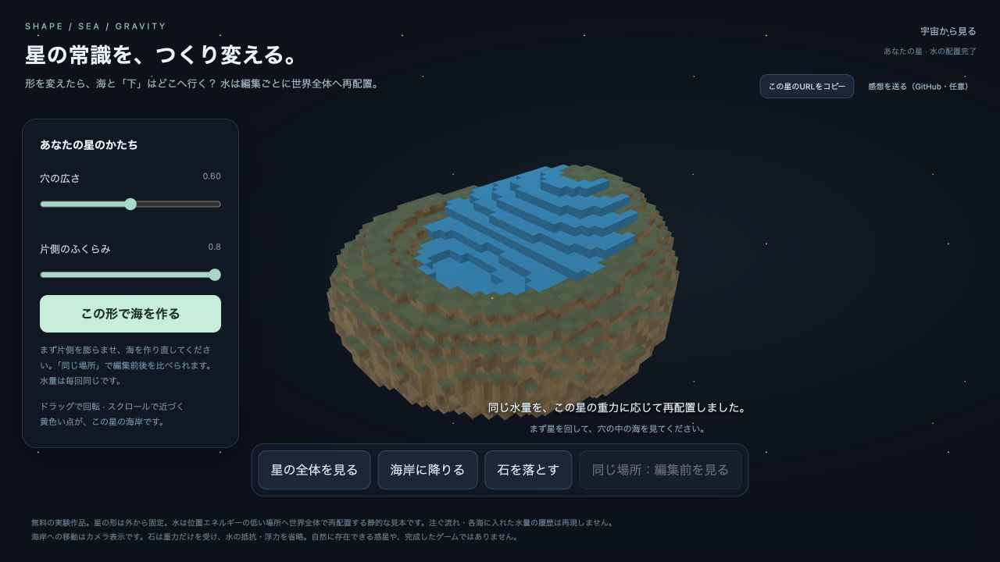

# 星の常識を、つくり変える。

星の片側を膨らませたら、反対側の海と「下」はどう変わる？

形を変え、その星の物質配置から求めた水の配置と重力を見比べる、無料のブラウザ実験です。AIと試作しています。PC向けで、追加インストールや有料APIは不要です。

## 最初に試すこと

1. 「片側のふくらみ」を右へ動かし、「この形で海を作る」を押します。
2. 「同じ場所：編集前／編集後を見る」で海の変化を比べます。
3. 「海岸に降りる」で見回し、「石を落とす」で引力だけによる軌跡を見ます。

編集の組み合わせによって前の場所が地形に近すぎる場合は、安全のため前後比較を保留します。

星の全体と海岸はドラッグで見回せます。穴の広さも変えられます。公開ページの「この星のURLをコピー」で、同じ形の設定を開けるURLを作れます。

## この見本の意味

水は編集ごとに、位置エネルギーの低い場所へ世界全体で再配置します。水が流れてそこへ到達する途中や、各海へ注いだ水量の履歴は計算していません。

星の形は外から固定し、自転・水自身の重力・水の抵抗・浮力を省略しています。海岸ビューはカメラの移動であり、人間の歩行ではありません。自然に存在できる惑星を予測するものではありません。箱形の海岸には計算格子の粗さが残ります。

物質の配置から重力を求める方法、静水圧の考え方、FFTは既存の数学・数値計算法です。新しい物理法則や、既存製品より優れていることを主張する作品ではありません。

## 試用の感想

「何が変わったと分かったか」「実際に二つ目の形を試したか。どの設定で、なぜ試したか」「分からなかったこと」を、[Issues](https://github.com/urawa-keiki/personal-gravity-world-demo/issues)で任意に教えてください。購入や評価を求めるものではありません。

このプログラムには、操作履歴の外部送信・解析用スクリプト・自動の感想送信はありません。GitHub Pages利用時には、ホスティング事業者による通常のアクセス記録があります。

